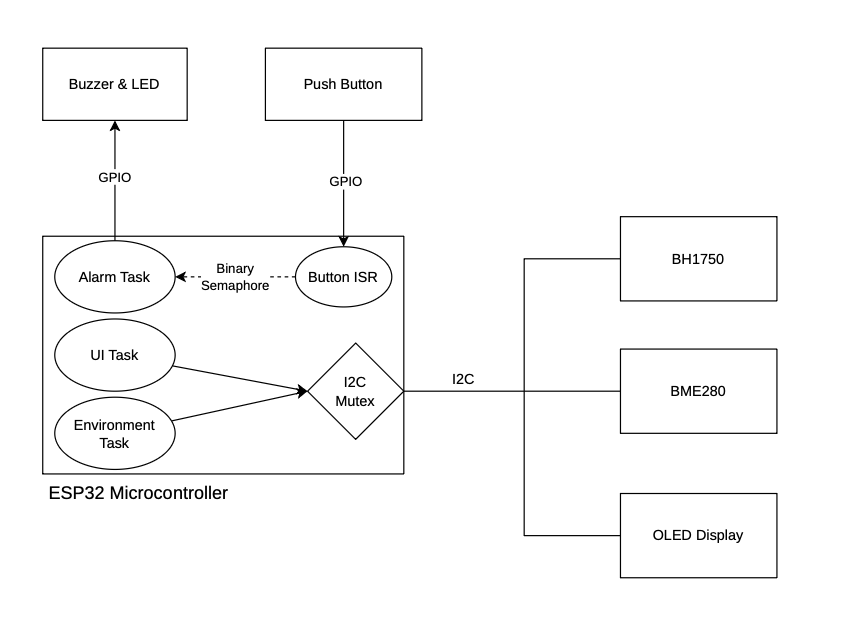
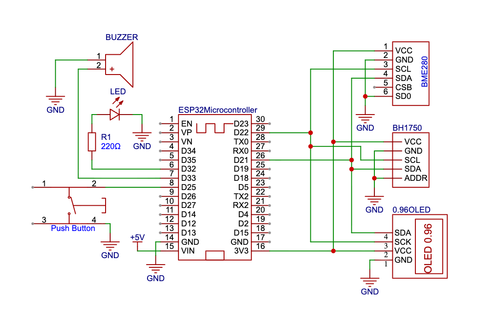

# ESP32 RTOS Environmental Monitor

A multitasking environmental dashboard built on the ESP32 with FreeRTOS. It reads temperature, humidity, pressure and light level from two I2C sensors, shows the values on an OLED, and sounds an alarm (LED + buzzer) when a button is pressed.

The goal of the project is to practice real RTOS design: splitting work into tasks, passing data safely between them, sharing one I2C bus without collisions, and waking a task from an interrupt.

## Features

- Reads temperature, humidity and pressure (BME280) and ambient light (BH1750) every 2 seconds
- Shows a live dashboard on a 128x64 SSD1306 OLED
- Prints the same readings to the Serial monitor (115200 baud)
- Button interrupt triggers a 1 second LED and buzzer alarm
- Separate FreeRTOS tasks for sensing, display and alarm

## Hardware

| Component | Interface | Address / Pin |
|---|---|---|
| ESP32 development board | - | - |
| BME280 (temperature, humidity, pressure) | I2C | 0x76 |
| BH1750 (light sensor) | I2C | 0x23 |
| SSD1306 OLED 128x64 | I2C | 0x3C |
| Push button | GPIO | 25 (input with internal pull-up, active low) |
| LED | GPIO | 32 |
| Buzzer | GPIO | 33 |

All three sensors share one I2C bus on the default `Wire` pins (SDA = GPIO 21, SCL = GPIO 22 on a standard ESP32 DevKit).

### Diagrams

**Block diagram**



**Schematic**



## Software Architecture

Three FreeRTOS tasks, plus one interrupt service routine:

| Task | Priority | Stack | Job |
|---|---|---|---|
| `TaskEnvironment` | 1 | 2048 | Reads both sensors every 2 s, prints to Serial, sends the data to the display task |
| `TaskDisplay` | 1 | 2048 | Sleeps until data arrives, then draws the dashboard on the OLED |
| `TaskAlarm` | 2 | 1024 | Sleeps until the button is pressed, then turns the LED and buzzer on for 1 s |

### How the pieces talk to each other

```
 TaskEnvironment ──(queue: SensorData)──▶ TaskDisplay
        │                                      │
        └──────── I2C mutex shared ────────────┘

 Button ──▶ ISR ──(binary semaphore)──▶ TaskAlarm
```

- **Queue** (`sensorQueue`, 5 items): carries a `SensorData` struct (temperature, humidity, pressure, lux) from the sensor task to the display task. The display task blocks on the queue, so it uses no CPU until new data arrives.
- **Mutex** (`i2cMutex`): the sensors and the OLED share one I2C bus, and the Arduino `Wire` library is not thread-safe. The mutex makes sure only one task uses the bus at a time.
- **Binary semaphore** (`button_semaphore`): given from the button ISR with `xSemaphoreGiveFromISR`, which wakes the alarm task. If that wakes a higher-priority task, `portYIELD_FROM_ISR()` switches to it immediately when the ISR exits.
- **Priorities:** the alarm task has the highest priority (2), so the button response is not delayed by sensor reads or screen redraws.

## Project Structure

```
esp32-rtos-environmental-monitor/
├── hardware/
│   ├── block_diagram.png
│   └── schematic.png
├── include/
├── src/
│   └── main.cpp
├── .gitignore
├── platformio.ini
└── README.md
```